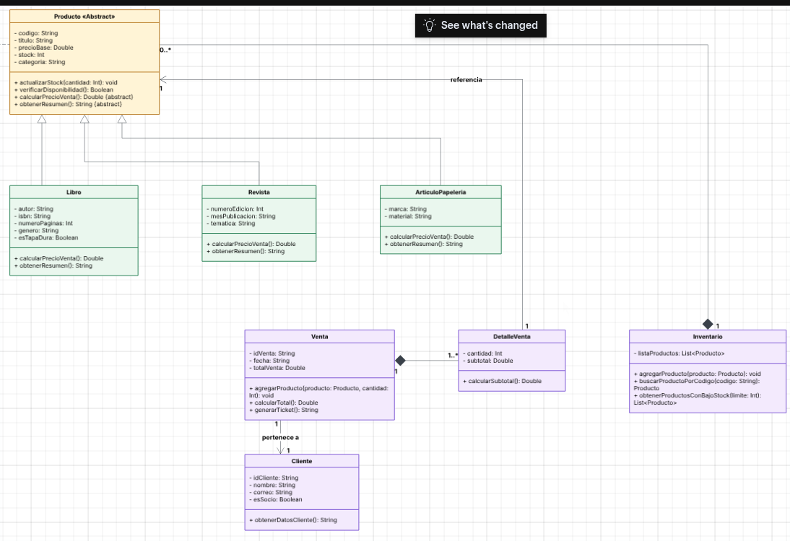

@startuml
skinparam classAttributeIconSize 0
skinparam monochrome true
skinparam shadowing false
skinparam defaultFontName Arial
skinparam class {
BackgroundColor White
BorderColor Black
ArrowColor Black
}

' ==========================================
' INTERFACES Y CLASES ABSTRACTAS
' ==========================================

interface IVendible <<Interface>> {
+ calcularPrecioVenta(): Double
+ obtenerResumen(): String
}

abstract class Producto <<Abstract>> {
- codigo: String
- titulo: String
- precioBase: Double
- stock: Int
- categoria: String
+ actualizarStock(cantidad: Int): void
+ verificarDisponibilidad(): Boolean
+ calcularPrecioVenta(): Double {abstract}
+ obtenerResumen(): String {abstract}
}

' ==========================================
' HERENCIA DE PRODUCTOS
' ==========================================

class Libro {
- autor: String
- isbn: String
- numeroPaginas: Int
- genero: String
- esTapaDura: Boolean
+ calcularPrecioVenta(): Double
+ obtenerResumen(): String
}

class Revista {
- numeroEdicion: Int
- mesPublicacion: String
- tematica: String
+ calcularPrecioVenta(): Double
+ obtenerResumen(): String
}

class ArticuloPapeleria {
- marca: String
- material: String
+ calcularPrecioVenta(): Double
+ obtenerResumen(): String
}

' ==========================================
' CLASES DE GESTIÓN Y PERSONAS
' ==========================================

class Cliente {
- idCliente: String
- nombre: String
- correo: String
- esSocio: Boolean
+ obtenerDatosCliente(): String
}

class DetalleVenta {
- cantidad: Int
- subtotal: Double
+ calcularSubtotal(): Double
}

class Venta {
- idVenta: String
- fecha: String
- totalVenta: Double
+ agregarProducto(producto: Producto, cantidad: Int): void
+ calcularTotal(): Double
+ generarTicket(): String
}

class Inventario {
- listaProductos: List<Producto>
+ agregarProducto(producto: Producto): void
+ buscarProductoPorCodigo(codigo: String): Producto
+ obtenerProductosConBajoStock(limite: Int): List<Producto>
}

' ==========================================
' RELACIONES
' ==========================================

' Herencia
Producto <|-- Libro
Producto <|-- Revista
Producto <|-- ArticuloPapeleria

' Implementación de Interfaz
IVendible <|.. Producto

' Asociaciones y Composiciones
Inventario "1" *-- "0..*" Producto : contiene >
Venta "1" *-- "1..*" DetalleVenta : contiene >
DetalleVenta "1" --> "1" Producto : referencia >
Venta "1" --> "1" Cliente : pertenece a >

@enduml